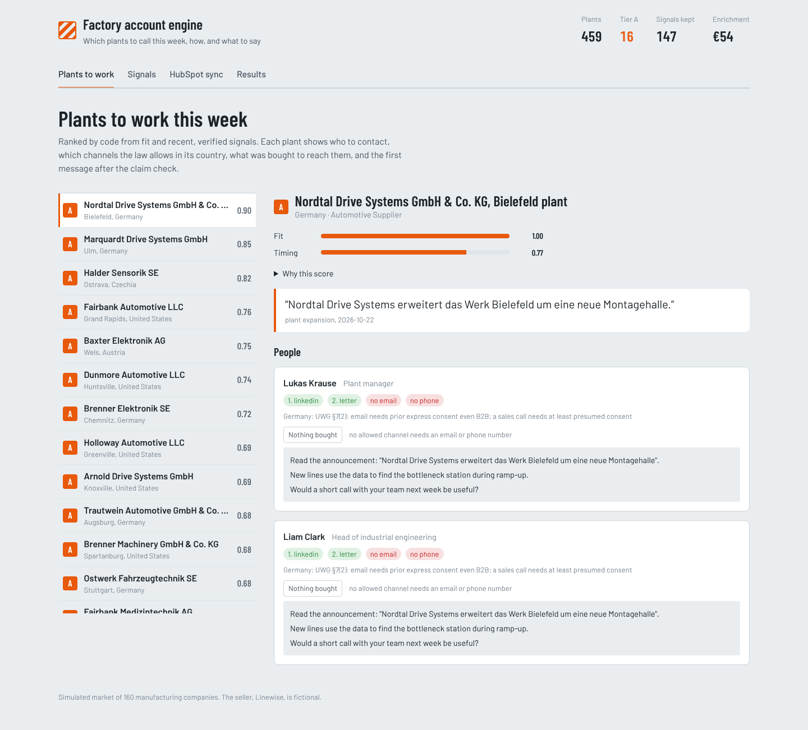
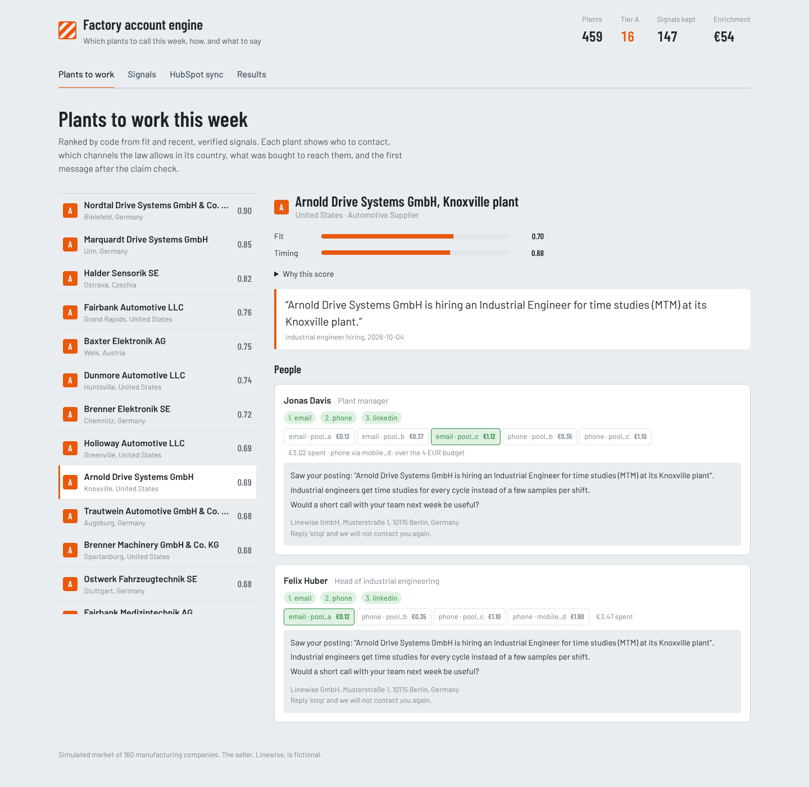
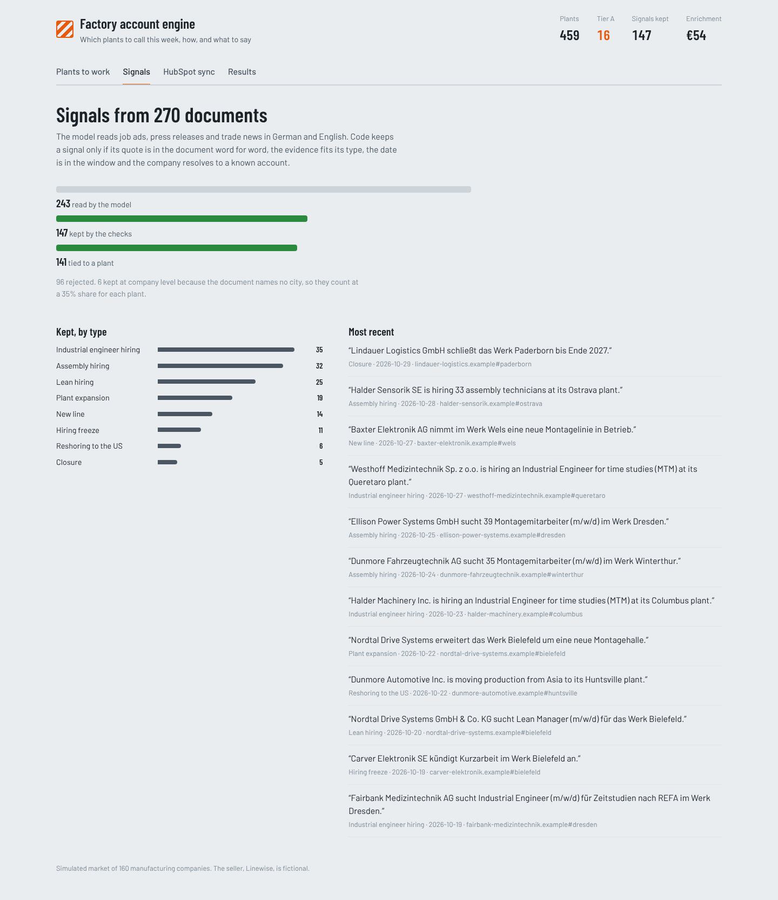
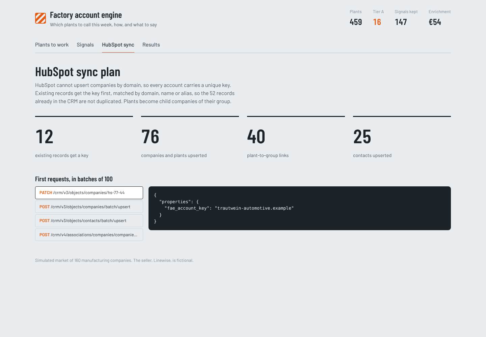
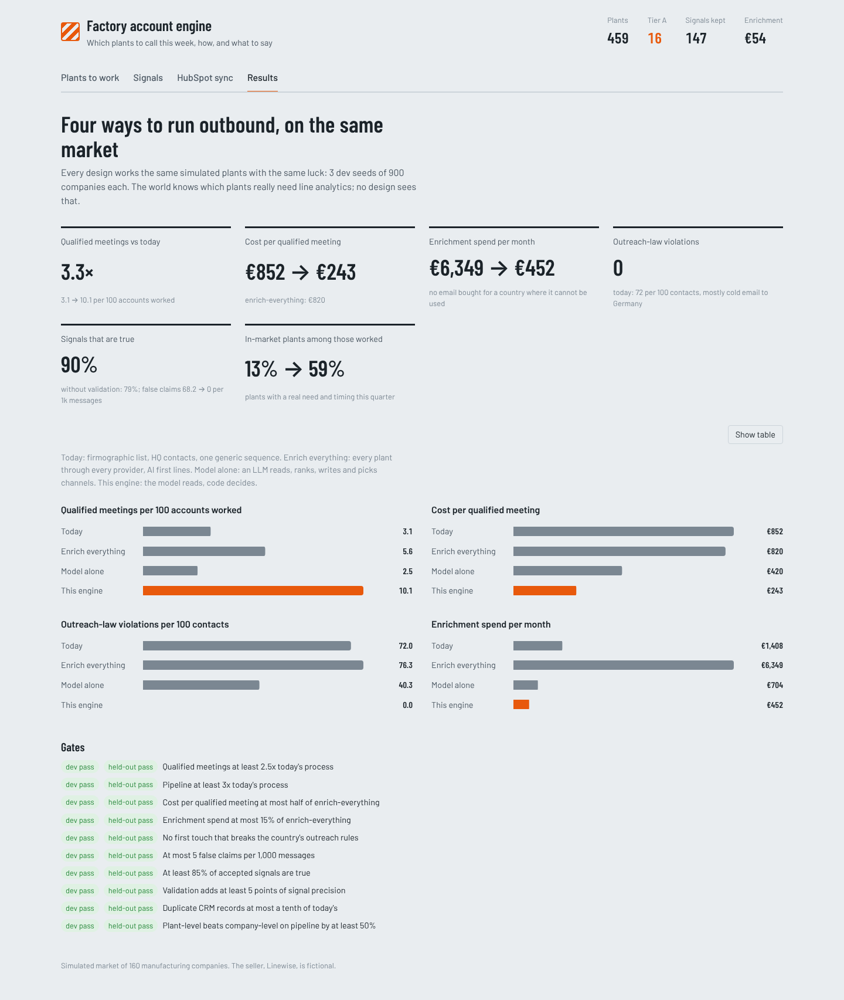
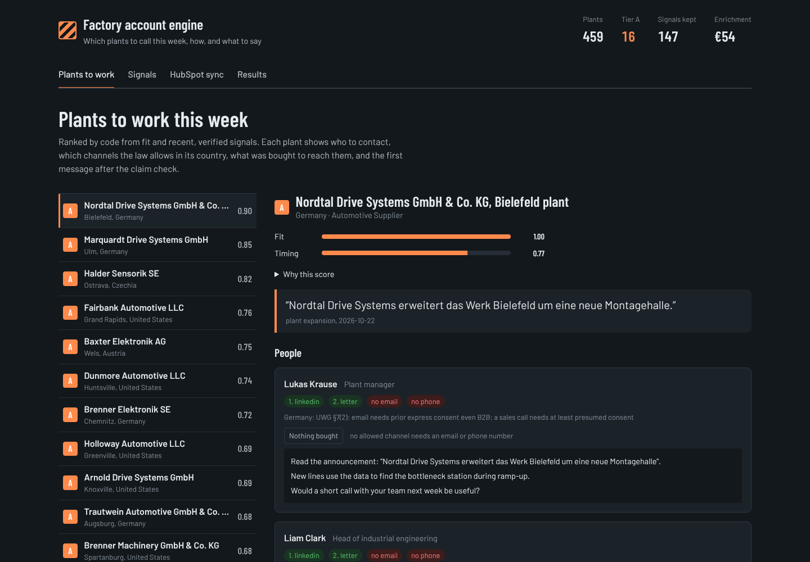

# factory-account-engine

Outbound for a company that sells AI line analytics to factories. Each week it answers three questions for the GTM team:
**which plants to work, how each person may be contacted in their country, and what to say.**

A language model reads job ads, press releases and trade news in German and English. Code decides everything else: whether
a signal is real, how a plant scores, which channels the law allows, what enrichment is worth buying, which sentences of a
message may go out, and what is written to HubSpot.

The seller in the demo, **Linewise**, is fictional; it sells video analytics for manual assembly lines (cycle times,
bottleneck stations, no faces stored). The market is simulated. Every number below comes from that simulation, not from
customers.



## Why plants, not companies

Line analytics is bought by a plant manager or head of industrial engineering for one plant, when that plant is
ramping a line, hiring time-study engineers or adding assemblers. A company-level list sends the same sequence to HQ for
a group with many plants, most of which have no need this quarter. The engine scores every plant on fit (industry,
plant type, number of manual lines) and timing (verified signals with a half-life), and works the plant's own people.

## Results

<!-- results:start -->
Dev seeds 201, 202, 203: a market of 900 manufacturing companies and their plants per seed. Every design works the same number of accounts per month, on the same market and the same luck.

| | | |
|---|---|---|
| **3.3×**<br>Qualified meetings vs today<br><sub>3.1 → 10.1 per 100 accounts worked</sub> | **€852 → €243**<br>Cost per qualified meeting<br><sub>enrich-everything: €820</sub> | **€6,349 → €452**<br>Enrichment spend per month<br><sub>no email bought for a country where it cannot be used</sub> |
| **0**<br>Outreach-law violations<br><sub>today: 72 per 100 contacts, mostly cold email to Germany</sub> | **90%**<br>Signals that are true<br><sub>without validation: 79%; false claims 68.2 → 0 per 1k messages</sub> | **13% → 59%**<br>In-market plants among those worked<br><sub>plants with a real need and timing this quarter</sub> |

### Designs

| Design | In-market plants worked | Qualified meetings / 100 accounts | Pipeline / month | Cost per qualified meeting | Enrichment / month | Outreach-law violations / 100 contacts | False claims / 1k messages | Duplicate CRM records / month |
|---|--:|--:|--:|--:|--:|--:|--:|--:|
| Firmographic list, HQ contacts, generic sequence (today) | 13% | 3.1 | €80k | €852 | €1,408 | 72 | 0 | 76.3 |
| Enrich every plant with every provider, AI first lines | 24% | 5.6 | €269k | €820 | €6,349 | 76.3 | 129 | 8 |
| LLM reads, ranks, writes and picks channels | 43% | 2.5 | €139k | €420 | €704 | 40.3 | 238.8 | 63.3 |
| Model reads, code decides | 59% | 10.1 | €504k | €243 | €452 | 0 | 0 | 3 |

<details><summary>Ablations: the platform with one safeguard removed</summary>

| Design | In-market plants worked | Qualified meetings / 100 accounts | Pipeline / month | Cost per qualified meeting | Enrichment / month | Outreach-law violations / 100 contacts | False claims / 1k messages | Duplicate CRM records / month |
|---|--:|--:|--:|--:|--:|--:|--:|--:|
| Model reads, code decides | 59% | 10.1 | €504k | €243 | €452 | 0 | 0 | 3 |
| Platform working companies, not plants | 55% | 8.9 | €208k | €282 | €396 | 0 | 0 | 3.7 |
| Platform without signal validation | 60% | 10.2 | €502k | €244 | €497 | 0 | 68.2 | 3 |
| Platform emailing every country | 59% | 10.1 | €511k | €144 | €871 | 65 | 0 | 3 |
| Platform without the claim check | 59% | 9.3 | €458k | €265 | €452 | 0 | 100.6 | 3 |
| Platform enriching with every provider | 59% | 11.9 | €594k | €285 | €3,174 | 0 | 0 | 3 |

</details>

### Gates

| Gate | Dev seeds | Held-out seeds |
|---|---|---|
| Qualified meetings at least 2.5x today's process | pass (10.1 >= 7.75) | pass (12.7 >= 8.25) |
| Pipeline at least 3x today's process | pass (504,000 >= 240,000) | pass (700,800 >= 275,400) |
| Cost per qualified meeting at most half of enrich-everything | pass (243 <= 410) | pass (189 <= 394) |
| Enrichment spend at most 15% of enrich-everything | pass (452 <= 952.35) | pass (448 <= 952.35) |
| No first touch that breaks the country's outreach rules | pass (0 == 0) | pass (0 == 0) |
| At most 5 false claims per 1,000 messages | pass (0 <= 5) | pass (0 <= 5) |
| At least 85% of accepted signals are true | pass (0.902 >= 0.85) | pass (0.898 >= 0.85) |
| Validation adds at least 5 points of signal precision | pass (0.902 >= 0.841) | pass (0.898 >= 0.83) |
| Duplicate CRM records at most a tenth of today's | pass (3 <= 7.63) | pass (3 <= 9.05) |
| Plant-level beats company-level on pipeline by at least 50% | pass (504,000 >= 312,000) | pass (700,800 >= 429,300) |

Held-out seeds 9201, 9202 ran once, after the gates were frozen; see `reports/heldout.lock`.

| Design | In-market plants worked | Qualified meetings / 100 accounts | Pipeline / month | Cost per qualified meeting | Enrichment / month | Outreach-law violations / 100 contacts | False claims / 1k messages | Duplicate CRM records / month |
|---|--:|--:|--:|--:|--:|--:|--:|--:|
| Firmographic list, HQ contacts, generic sequence (today) | 14% | 3.3 | €92k | €801 | €1,408 | 72 | 0 | 90.5 |
| Enrich every plant with every provider, AI first lines | 23% | 5.8 | €311k | €788 | €6,349 | 76.3 | 122.2 | 10 |
| LLM reads, ranks, writes and picks channels | 46% | 1.9 | €134k | €571 | €704 | 41.4 | 236.1 | 69.5 |
| Model reads, code decides | 59% | 12.7 | €701k | €189 | €448 | 0 | 0 | 3 |
<!-- results:end -->

The full report with every design and ablation is in [REPORT.md](REPORT.md).

### What the ablations show

- **Plants, not companies.** Working the same budget at company level costs 59% of the pipeline: the signal is usually
  about one plant.
- **Channel rules.** Emailing every country looks cheaper per meeting and books the same meetings, but 65 of every 100
  contacts get a first touch that breaks the country's rules (UWG §7 in Germany, TKG §174 in Austria). That cost does not
  show up in a funnel; it shows up as a warning letter.
- **Signal validation.** Without it, 68 of every 1,000 messages cite something the document never said.
- **The waterfall.** Buying from every provider adds almost two meetings per 100 accounts and costs seven times the
  enrichment, so each meeting costs more.

## How it works

```
documents ─► model reads ─► validate ─► score plants ─► pick contacts ─► channel rules ─► enrich ─► draft ─► claim check ─► HubSpot plan
 (n8n)       (Claude)       (code)      (code)           (code)          (code, per country) (code)  (model)   (code)          (code)
```

| Step | Who | What decides |
|---|---|---|
| Read | Claude, `src/core/model/readers.ts` | Returns typed candidates with a verbatim quote. Documents are fenced as data. A regex reader is the fallback and the offline default. |
| Validate | `src/core/signals/validate.ts` | The quote is in the document word for word; it contains evidence terms for its type; the date is inside the window; the company resolves through names and aliases with no fuzzy match; the city must be in the document or the signal stays at company level. |
| Score | `src/core/accounts/score.ts` | Fit × timing with per-type weights and half-lives from `config/seller/playbook.json`. Company-level signals count at a 35% share. A closure puts the plant in tier C; an unserved country scores zero. |
| Channels | `src/core/outreach/channel.ts` | Per-country rules in `config/seller/channels.json`. Germany: email needs express consent, a call needs at least presumed consent. Unknown countries get the strictest rule. Suppression by contact key is final. |
| Enrich | `src/core/enrich/waterfall.ts` | Buys only the fields an allowed channel can use, cheapest provider per expected hit first, inside the tier's budget, and verifies email. A German plant manager without consent gets nothing bought. |
| Draft and check | `src/core/outreach/message.ts` | Every fact sentence must cite a validated signal or an approved proof point; the ask may state no facts. A message without a cited signal is not sendable. |
| Sync | `src/core/crm/hubspot.ts` | HubSpot cannot upsert companies by domain, so each account gets a unique `fae_account_key`. Existing records get the key first (matched by domain, name or alias), then batch upserts of 100, plants linked to their group as child companies. |



## The lab

`src/lab/world/` holds a market of companies and plants with hidden truth: which plants really need line analytics, which
are in market this quarter, which are closing, what each contact consented to, and which providers know which emails.
Documents are generated from that truth in German and English, with the noise real feeds have (group names and abbreviations,
job ads that name the HQ city instead of the plant, old posts, duplicate postings, companies with similar names).

Nine designs work the same accounts per month on the same luck (`u(seed, entity, purpose)` for every draw):

| Design | What it does |
|---|---|
| Today | Firmographic list, HQ contacts, one generic email-and-call sequence |
| Enrich everything | Every plant through every provider, AI first lines (a typical Clay table) |
| Model alone | An LLM reads, ranks, writes and picks channels on its own |
| This engine | The model reads, code decides |
| Ablations | The engine with one safeguard removed: company-level, no validation, no channel rules, no claim check, enrich with every provider |

The simulated model makes read and draft errors at rates set in `config/lab/world.json`. Only the scorer in
`src/lab/study.ts` reads the truth. Ten gates in `config/lab/gates.json` were frozen before the held-out seeds ran once.

## Console

`web/` is a React console for the GTM team: plants to work (signal, score, contacts, channel decisions with their legal
basis, the waterfall, the message with each sentence's verdict), the signal intake funnel, the HubSpot sync plan, and the
results.

| | |
|---|---|
|  |  |
|  |  |

## n8n workflows

`n8n/` holds four importable workflows. They call the engine's API; they do not hold logic.

| Workflow | Trigger | Does |
|---|---|---|
| `signal-intake.json` | every 6 hours | Fetches job-board and news feeds, posts new documents to `/v1/signals` |
| `weekly-tiering.json` | Monday 07:00 | Calls `/v1/score`, posts newly tier-A plants to Slack |
| `hubspot-sync.json` | nightly 02:00 | Calls `/v1/sync/plan` and sends the planned requests to HubSpot in order |
| `reply-handler.json` | reply webhook | On an opt-out, calls `/v1/suppress`; otherwise creates a task for the SDR |

## API

`npm run serve` starts the service on port 8790 over the demo account export. Every request needs `x-api-key`
(`FAE_API_KEYS`, comma-separated; `fae-demo-key` locally). Set `ANTHROPIC_API_KEY` to read documents with Claude.

| Endpoint | Body | Returns |
|---|---|---|
| `GET /health` | | counts of companies, plants and signals |
| `POST /v1/signals` | `{ docs: [{ id, source, publishedAt, text }] }` | accepted, duplicates, rejected with reasons. A posting copied to several boards counts once. |
| `POST /v1/score` | | tiers and the plants that became tier A since the last call |
| `POST /v1/suppress` | `{ contactKey, reason }` | Suppression is final; no later sync contacts that person. |
| `POST /v1/sync/plan` | `{ accountsToWork }` | the HubSpot requests to send, in order, and the enrichment spend |

```bash
docker build -t factory-account-engine . && docker run -p 8790:8790 factory-account-engine
curl -s -X POST localhost:8790/v1/score -H 'x-api-key: fae-demo-key' | jq '.newTierA[0]'
```

## Run it

```bash
npm ci && (cd web && npm ci)
npm run typecheck && npm test      # 30 tests, a few seconds
npm run lab:check                  # dev results reproduce exactly, then every gate
npm run demo && npm run report     # regenerate the demo data, REPORT.md, this dashboard and the console data
cd web && npm run build && npm run preview   # console on :4174
```

Node 22 runs the TypeScript directly (type stripping); no build step for the service.

## Limits

- **The market is simulated.** Need, timing, consent and provider coverage come from `config/lab/world.json`, not from
  data. The numbers show how the designs compare under the same assumptions, not what a real campaign would book.
- **The law table is a simplification.** It encodes the first-touch rule per channel and country (UWG §7, TKG §174,
  PECR, CAN-SPAM). It is not legal advice, ignores Robinson lists and internal policies, and a legal team should own
  `config/seller/channels.json`.
- **No real provider or HubSpot calls.** Enrichment providers are a demo adapter answering from the export; the HubSpot
  plan is built and tested but not sent from this repository. The n8n workflows send it.
- **The regex reader is the default.** It covers eight signal types in German and English. The Claude reader is
  implemented and fenced, but the reported numbers use the simulated model, not Claude.
- **No reply handling beyond suppression.** Meeting booking, reply classification and sequence steps after the first
  touch are out of scope.

## Repository

| Path | What |
|---|---|
| `src/core/` | Signals, scoring, channels, enrichment, messages, HubSpot plan, readers, pipeline |
| `src/server/` | Fastify API |
| `src/lab/` | World, simulated model, designs, studies, reports, CLI |
| `config/` | Seller playbook and channel rules, platform settings, lab settings |
| `n8n/` | Workflows |
| `web/` | Console |
| `docs/adr/` | Decisions |

[AGENTS.md](AGENTS.md) has the invariants for anyone changing the code. [SKILLS.md](SKILLS.md) lists the repeatable tasks.

MIT licence. Built by Manoj Kumar Prakash.
